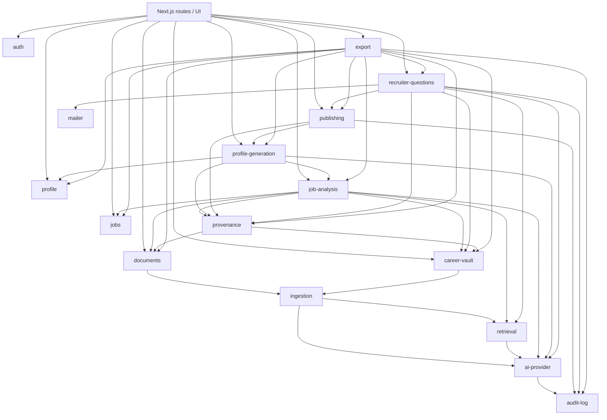

# Architecture (DRAFT — for review)

Status: draft, not approved. Nothing in this document is implemented yet.
Inputs: `CLAUDE.md`, `docs/PRODUCT_BRIEF.md`.
Legal items referenced here are collected in `docs/LEGAL_REVIEW.md`.

Conventions used below:
- **Proposal** — what I recommend; needs approval.
- **Option A / B** — a real choice with trade-offs; needs a decision.
- **Open question** — I cannot resolve it from the brief; listed in section 11.

---

## 1. Product interpretation

In this pilot we build a single-user web application for the owner that:

1. Stores the owner's professional material: original documents plus structured items (experiences, projects, achievements, skills, education, certifications, thoughts/insights).
2. Takes a pasted job posting, extracts its requirements, and finds evidence for each requirement in the owner's material.
3. Generates a draft landing page for that one opportunity, where every statement about the owner is traceable to a source item. Statements without a source, or with numbers/names not found in the source, are rejected by code.
4. Lets the owner edit and publish the page as an immutable snapshot at an unguessable public URL.
5. Lets a recruiter viewing that page submit a small number of follow-up questions without an account. The system drafts an answer from the vault (or asks the owner to answer); nothing reaches the recruiter until the owner approves it.
6. Optionally saves an approved answer back into the vault.
7. Exports everything as one portable package.

The pilot's purpose is to measure two things: whether the opportunity-specific, evidence-based page works better than a CV alone, and whether recruiters use the question feature. That means the pilot also needs minimal, privacy-respecting measurement (see open question Q11). The brief does not define how "works better" is measured.

What it is not, in this phase: a multi-user service, a search across people, a CV builder.

## 2. Pilot scope

### Included (from brief §8)
Sign in · profile · upload career material · Career Vault · add job (pasted text) · job analysis · evidence retrieval · opportunity-specific profile · review · publish shareable link · recruiter question · vault search · draft answer · owner approves/edits · recruiter receives answer · optional save to vault · full data export.

### Excluded (from brief §8 and CLAUDE.md §3)
Other users, sign-ups, recruiter accounts, cross-user matching, pseudonymisation, identity/professional data separation, consent workflows, recruiter challenges, conversational onboarding, URL/document job import.

### Parts that still look too large for a first working version

| Item | Why it is large | Proposal |
|---|---|---|
| AI extraction of structured vault items from uploaded documents | Needs a proposal → confirm UI per item type, its own provenance, many edge cases | Defer. In the first slice the owner enters structured items manually; documents are chunked and retrievable as evidence directly. |
| Parsing PDF/DOCX | Parser choice, layout problems, scanned PDFs | First slice: plain text / Markdown / paste. PDF and DOCX text extraction in a later phase. |
| Five vault categories with separate UIs | UI volume | One generic item editor with a type selector; category views are filters. |
| Recruiter question flow | Public endpoint, email delivery, abuse protection, recruiter personal data, legal items | Separate phase after publishing works. |
| Profile learning (save answer to vault) | Small on its own, but depends on the question flow | Last phase. |
| i18n (FI/EN) | Cheap if set up from the start, expensive to retrofit | Set up the mechanism in Phase 0; translate UI strings as screens are built. |

### Proposed smaller first slice
**Slice 1 ("evidence works")**: sign in → manual vault items + text documents → paste job → job analysis → evidence matches with sources and "why does it say this?" → data export.

No public pages, no recruiter flow, no PDF parsing, no AI extraction into the vault. This slice already tests the core risk (can evidence matching be done reliably without invented facts) before any public endpoint exists. Publishing and recruiter questions follow as separate phases (section 10).

## 3. Architecture

```
Browser ──► Next.js (App Router, server-rendered)
              │  UI components (no business logic)
              │  Route handlers / server actions (validate input with zod, resolve session)
              ▼
            Module services (TypeScript, typed interfaces)
              │
              ├─► Repositories (interfaces) ──► Supabase implementation (Postgres + RLS, pgvector, Storage)
              └─► ai-provider (interface) ──► LLM provider / embedding provider
```

**Frontend.** Next.js App Router, React, TypeScript, Tailwind. A component library (e.g. shadcn/ui) for forms and tables. i18n with a library such as `next-intl`; locale is a user setting, not part of business logic.

**Backend.** Runs inside the same Next.js deployment (route handlers, server actions). No separate backend service in the pilot. All business logic is in `src/modules/*` services; route handlers only authenticate, validate and call a service.

**Long-running work** (chunking, embedding a large document, generation). Proposal: a simple `jobs_queue` table processed by a route invoked on completion of upload plus a manual "retry" button. No external queue service in the pilot. Open question Q7 if generation latency exceeds the hosting provider's request timeout.

**Database.** Supabase Postgres in an EU region, pgvector for embeddings, Postgres full-text search for keyword retrieval. All schema changes as SQL migrations in `supabase/migrations/`.

**File storage.** Supabase Storage, one private bucket, object paths `{user_id}/{document_id}/{filename}`, access only through short-lived signed URLs created server-side.

**AI layer.** `ai-provider` module exposes `generateStructured(task, input, schema)` and `embed(texts)`. Only this module imports provider SDKs. Generation provider and embedding provider are configured separately (they may be different companies).

**Retrieval layer.** `retrieval` module: hybrid search = vector similarity (pgvector) + keyword search (Postgres FTS), merged with reciprocal rank fusion. Behind an `EvidenceIndex` interface so it can later be backed by SQLite (FTS5 + a vector extension) or an in-memory index.

**Deployment.** Proposal: Vercel or any Node host for Next.js, Supabase cloud (EU). Kept provider-independent: no Vercel-specific APIs in modules; environment variables only. Hosting region and sub-processors are a legal review item.

## 4. Module structure

Modules from CLAUDE.md §4, plus two additions I propose (marked *new*):

| Module | Responsibility | Public interface (examples) |
|---|---|---|
| `auth` | Session resolution, owner check, sign-ups disabled | `requireOwner(): UserContext` |
| `profile` | Owner's basic profile (name, headline, contact, locale) | `getProfile`, `updateProfile` |
| `career-vault` | Structured vault items, their relations, visibility | `createItem`, `updateItem`, `deleteItem`, `listItems`, `getItems(ids)` |
| `documents` | Original files, metadata, signed URLs | `uploadDocument`, `getSignedUrl`, `deleteDocument`, `getChunks(ids)` |
| `ingestion` | Text extraction, chunking, language detection, triggering embeddings | `ingestDocument(id)`, `reindexItem(id)` |
| `retrieval` | Hybrid search over chunks and vault items | `search(query, opts): Candidate[]` |
| `jobs` | Job postings (pasted text) | `createJob`, `getJob`, `listJobs` |
| `job-analysis` | Requirement extraction; evidence matching per requirement | `analyzeJob(jobId)`, `matchEvidence(jobId)` |
| `profile-generation` | Draft opportunity profiles, sections, owner edits | `generateDraft(jobId)`, `updateSection`, `regenerateSection` |
| `publishing` | Immutable snapshots, slugs, withdraw; public read | `publish(draftId)`, `withdraw(snapshotId)`, `getPublicSnapshot(slug)` |
| `recruiter-questions` | Public question intake, answer drafting, approval, delivery | `submitQuestion`, `draftAnswer`, `approveAnswer`, `declineQuestion` |
| `export` | Full data export package | `createExport(): Package` |
| `audit-log` | Append-only log of security-relevant actions | `record(event)` |
| `ai-provider` | Provider abstraction, call logging (generation records) | `generateStructured`, `embed` |
| `provenance` *new* | Claim schema, validation (citations, numbers, names, quotes), claim/source storage, "why" lookups | `validateClaims(output, sentSources)`, `explainClaim(claimId)` |
| `mailer` *new* | Transactional email (recruiter confirmation and answer notification) | `send(template, to, params)` |

Why `provenance` is separate: claims are produced by job analysis, profile generation and recruiter answers. CLAUDE.md §4 forbids duplicated logic, so validation lives in one place.

Why `mailer` is separate: the recruiter flow needs email; keeping the email provider behind an interface keeps it swappable. It is only needed from the recruiter phase onwards.

Each module has the same layout:

```
src/modules/<name>/
  index.ts            # the only file other modules may import
  service.ts          # business logic
  repository.ts       # repository interface
  repository.supabase.ts
  schemas.ts          # zod schemas for input at the boundary
  types.ts
```

### Dependency diagram



Notes:
- `ingestion` is triggered by `documents` and `career-vault` through an event-style call (`ingestion.onItemChanged(ref)`), not by `ingestion` reading their tables.
- `provenance` resolves source content through `career-vault.getItems` and `documents.getChunks`; it does not read their tables.
- `auth` is used by every route; omitted from the diagram for readability.
- Cycles are not allowed. Deletion needs to notify dependants (section 5.6); this goes through an event list owned by the deleting module (`onDeleted` subscribers registered at startup), not reverse imports.

## 5. Data model proposal

All tables: `id uuid` (generated in the application, UUIDv7, so ids stay stable across export/import), `user_id uuid not null`, `created_at`, `updated_at` (UTC). RLS enabled on every table. Indexes not listed.

### 5.1 Owner data

| Table | Key fields |
|---|---|
| `profiles` | `user_id` (PK), `display_name`, `headline`, `contact_email`, `locale`, `visibility` |
| `documents` | `title`, `kind` (cv, article, post, presentation, other), `storage_path`, `mime_type`, `sha256`, `language`, `visibility`, `ingest_status` |
| `document_chunks` | `document_id`, `ordinal`, `text`, `char_start`, `char_end`, `language`, `content_hash` |
| `vault_items` | `item_type` (experience, project, achievement, skill, education, certification, thought), `title`, `body`, `organisation`, `date_from`, `date_to`, `attributes jsonb`, `language`, `origin` (user_entered, saved_answer, extracted_confirmed), `visibility` |
| `vault_item_links` | `from_item_id`, `to_item_id`, `relation` (e.g. achievement → experience) |
| `vault_item_sources` | `item_id`, `source_type` (document_chunk, recruiter_answer), `source_id` — where a vault item came from, if not typed by hand |
| `embeddings` | `target_type` (document_chunk, vault_item), `target_id`, `model`, `dimensions`, `embedding vector`, `content_hash` |

**Option A (proposal): one `vault_items` table** with `item_type` and a type-specific `attributes jsonb` validated by zod per type (e.g. achievement: `metric`, `value`, `unit`, `baseline`, `period`).
+ One retrieval target, one export file, simple SQLite mapping, fewer migrations.
− Type-specific constraints are enforced in code, not the database.

**Option B: one table per type** (`experiences`, `achievements`, ...).
+ Database-level constraints.
− More tables, more repository code, retrieval and export must union them.

`embeddings` is a separate table so the embedding model can be changed by re-embedding without touching source rows; `model` records which model produced each vector. `content_hash` lets ingestion skip unchanged content.

### 5.2 Jobs and analysis

| Table | Key fields |
|---|---|
| `jobs` | `title`, `company`, `raw_text`, `language`, `status` |
| `job_requirements` | `job_id`, `kind` (responsibility, required_skill, preferred_skill, leadership, industry, technical, behavioural, business_challenge, underlying_need), `text`, `importance`, `source_span` (char range in `raw_text`), `inferred bool` |
| `evidence_matches` | `requirement_id`, `source_type`, `source_id`, `retrieval_score`, `rank`, `rationale_claim_id`, `owner_decision` (pending, accepted, rejected) |

"Possible underlying needs" (brief §4) are inferences about the job, not about the owner. They are stored with `inferred = true` and shown as such. They do not violate CLAUDE.md §1, which concerns facts about the user.

### 5.3 AI calls, claims, provenance

| Table | Key fields |
|---|---|
| `ai_generations` | `task` (job_analysis, evidence_rationale, profile_section, recruiter_answer, embedding), `provider`, `model`, `prompt_version`, `input_source_refs jsonb` (list of `{type, id, content_hash}` sent), `output jsonb`, `validation_result jsonb`, `status` (accepted, partially_rejected, rejected, error), `token_usage`, `created_at` |
| `claims` | `generation_id`, `owner_type` (profile_section, evidence_match, recruiter_answer), `owner_id`, `ordinal`, `text`, `authored_by` (ai, owner), `validation_status` (valid, rejected, source_missing), `rejection_reasons jsonb` |
| `claim_sources` | `claim_id`, `source_type` (vault_item, document_chunk, owner_answer), `source_id`, `support_quote`, `source_content_hash` |

`ai_generations` satisfies CLAUDE.md §2 (generation record) and §3 (log which source items were sent). Proposal: store full output, but store inputs as references + hashes rather than a full copy of the prompt, to avoid a second copy of vault content. The exact prompt can be reconstructed from `prompt_version` + referenced sources as long as they have not changed (`content_hash` shows whether they have). Option: store full prompts for debugging during the pilot — trade-off is duplication of personal data.

Owner edits: when the owner rewrites a sentence, the new text is a claim with `authored_by = owner` and no required citation. The UI shows owner-authored and AI-generated claims differently in the editor (not on the public page). Open question Q4: should owner-authored text also go through the number/name check as a warning?

### 5.4 Profiles and published snapshots

| Table | Key fields |
|---|---|
| `profile_drafts` | `job_id`, `title`, `status` (draft, published_at_least_once), `visibility` (always private) |
| `profile_sections` | `draft_id`, `kind` (intro, why_this_opportunity, key_experience, achievements, projects, thinking, writing, timeline, skills, contact), `ordinal`, `included bool` |
| `profile_snapshots` | `draft_id`, `version int`, `slug`, `content jsonb`, `content_hash`, `locale`, `questions_enabled bool`, `published_at`, `withdrawn_at` |
| `snapshot_sources` | `snapshot_id`, `source_type`, `source_id`, `source_content_hash` |

- `content` is self-contained: rendered sections, the claims' text, and display versions of cited material. The public page reads only this column.
- Immutability: a database trigger rejects any `UPDATE` of `content`, `content_hash`, `version`, `slug`; only `withdrawn_at` and `questions_enabled` can change. The `publishing` service enforces the same rule (defence in depth; also keeps the rule when the backend is not Postgres).
- `slug`: random, at least 128 bits, URL-safe. Not derived from name or job.
- `snapshot_sources` records which vault items a published version used, for the deletion flow (5.6) and export.

### 5.5 Recruiter questions

`LEGAL_REVIEW:` A3, A15

| Table | Key fields |
|---|---|
| `recruiter_questions` | `snapshot_id`, `recruiter_name`, `recruiter_email`, `recruiter_organisation`, `question`, `status` (unconfirmed, pending_owner, answered, declined, expired), `email_confirmed_at`, `submitted_at`, `retain_until` |
| `question_answers` | `question_id`, `draft_generation_id`, `draft_found_material bool`, `final_text`, `status` (draft, approved, declined), `approved_at`, `delivered_at`, `saved_to_vault_item_id` |
| `answer_access_tokens` | `question_id`, `token_hash`, `expires_at` |

`user_id` on these rows is the owner's id (the data belongs to the owner's account). The recruiter fields are exactly the four allowed by CLAUDE.md §3. Rate limiting needs a transient key (see 6.3); it is not stored on these rows.

### 5.6 Audit

`audit_log`: `actor` (owner, system, anonymous), `action`, `target_type`, `target_id`, `metadata jsonb`, `created_at`. Append-only (no UPDATE/DELETE policy). Logs: sign-ins, publish, withdraw, question submitted, answer approved/delivered, export created, deletions, every AI call (by reference to `ai_generations`).

### 5.7 Visibility and its later extension to a permission set

Now: `visibility text not null default 'private' check (visibility in ('private','published'))` on `profiles`, `documents`, `vault_items`, `jobs`, `profile_drafts`, `claims` (via owner), `profile_snapshots` (always `published` while not withdrawn).

Rules that keep the later change cheap:
1. Code never compares the string directly. All checks go through one shared helper, e.g. `visibility.allows(item, 'public_output')`. When the column becomes a set, only this helper and the migration change.
2. The mapping to a future set is lossless because the current domain has two values:
   `private → {}` and `published → {'public_profiles'}`.
3. Future migration (not done now):
   ```sql
   alter table vault_items add column permissions text[] not null default '{}';
   update vault_items set permissions = '{public_profiles}' where visibility = 'published';
   -- switch helper to read permissions; later drop column visibility
   ```
   New permissions (`matching`, `public`, `share_on_request`, ...) are then additional array values. A separate `item_permissions` table is the alternative if per-permission metadata (granted_at, expires_at, granted_to) is needed; the array is sufficient for independent on/off flags.

What `published` means for a vault item in the pilot is not defined in the brief. **Open question Q1.** Proposal: drafts may cite private items (a draft is private too). At publish time the owner sees the list of vault items the snapshot cites; confirming publish marks those items `published`, meaning "the owner has allowed this item in public output". The snapshot content itself is still a copy; the flag records the owner's decision and supports later permission sets.

### 5.8 Deleting a source item — effect on derived items and snapshots

`LEGAL_REVIEW:` A9, A15

Proposal:

| Derived data | Effect when a vault item or document is deleted |
|---|---|
| Document chunks, embeddings | Deleted with the source (hard delete). File removed from storage. |
| Vault items created from the deleted document | Kept (the owner confirmed them), their `vault_item_sources` row removed; UI marks "original source deleted". |
| Claims citing the source (in drafts, evidence matches, unsent answers) | `validation_status = source_missing`. Not shown as normal content; the owner is offered regenerate or rewrite. |
| Published snapshots citing the source | Not changed automatically (they are immutable copies). The owner is shown which live snapshots cite it and offered: withdraw, or publish a new version without it. |
| Answers already delivered to recruiters | Cannot be recalled. The owner is told this before deleting. The delivered answer row stays until its retention ends or the owner deletes it. |
| `ai_generations` | Kept, but `input_source_refs` keep only id + hash; output text may contain the deleted content. Option: redact `output` of generations that cite the deleted item. |
| Export packages already downloaded | Outside the system's control. |

Alternative: cascade deletion into snapshots (automatically withdraw any snapshot citing the item). Simpler for the owner, but silently breaks links already sent to recruiters. I recommend the explicit choice above. Final rules depend on legal review (deletion, see `LEGAL_REVIEW.md`).

## 6. Privacy and security

### 6.1 Authentication
- Supabase Auth, sign-ups disabled in project settings. The owner account is created once with an admin script (service role key, run locally, not part of the app).
- Proposal: email + password with TOTP MFA, or magic link. **Open question Q2.**
- `auth.requireOwner()` on every server action and route handler that touches owner data. It checks session and that `user.id` equals the configured owner id. The owner-id check is pilot-only and lives in one place.

### 6.2 Row Level Security
- Every user-data table: `enable row level security` and policies `using (user_id = auth.uid())` / `with check (user_id = auth.uid())`.
- Server code uses the user's session (anon key + JWT), so RLS applies. The service role key is used only in: admin scripts, the public snapshot read function, recruiter question intake, and background ingestion — each behind a narrow function, never passed to general repositories.
- Services also filter by `user_id` explicitly. RLS is the second line, not the only one. This also keeps permission checks in place if the backend becomes SQLite (no RLS there).
- Tests: a second test user (created only in the test environment) must get zero rows and failed writes on every table.

### 6.3 Public endpoints

`LEGAL_REVIEW:` A3, A4, A5, A10, A12

**Public profile page** `/p/{slug}`:
- Reads through a security-definer SQL function `get_public_snapshot(slug)` that returns only `content`, `locale`, `questions_enabled` for a non-withdrawn snapshot. Anonymous role has no direct table access.
- No analytics scripts in the pilot unless decided (Q11). `noindex` by default (Q10).

**Recruiter question form** `POST /api/p/{slug}/questions`:
- Fields: name, email, organisation, question. zod validation, length limits.
- Honeypot field and minimum submit time.
- Rate limiting: per IP and per snapshot. Needs a transient key (hashed IP with short TTL). This is processing of data beyond the four fields. **Open question Q8 and legal review.**
- Per-snapshot caps: max N questions per recruiter email, max M per day per snapshot (N, M configurable).
- Email confirmation: the question enters the owner's queue only after the recruiter clicks a confirmation link. This verifies the email address and filters most automated spam.
- Owner can disable questions per snapshot.
- Optional CAPTCHA (third-party, legal review) if the above is insufficient.

### 6.4 What each AI flow sends to the provider

`LEGAL_REVIEW:` A1, A2, A8

| Flow | Sent to generation provider | Sent to embedding provider | Not sent |
|---|---|---|---|
| Ingestion | — | Chunk text, vault item text | File binaries, metadata |
| Job analysis | Job posting text | Requirement texts (as queries) | Any vault content |
| Evidence matching | Requirement text + top-k retrieved candidate items/chunks (ids, text) | — | The rest of the vault |
| Profile generation | Job analysis summary + evidence the owner accepted + profile headline | — | Name, contact details (inserted by template at render time), rejected evidence |
| Recruiter answer draft | Question text + top-k retrieved items/chunks | Question text | Recruiter name, email, organisation |
| Vault extraction (later phase) | Chunks of the one document being processed | — | Other documents |

All of these go through `ai-provider`, which records the source references sent in `ai_generations`. Documents can contain personal data of third parties (colleagues, references); that data reaches the provider if it is in a sent chunk — legal review item.

### 6.5 Files
Private bucket, path prefix `{user_id}/`, storage RLS policy on that prefix, signed URLs with short expiry (e.g. 60 s) created server-side on request. No public bucket. Files are never embedded into public snapshots; a snapshot can reference "selected writing" only as text the owner approved (or a link the owner provides).

### 6.6 Secrets
Environment variables only (`.env.local`, hosting provider's secret store). `.env*` in `.gitignore` (already there). Service role key never reaches the browser bundle; a build-time check for `SUPABASE_SERVICE_ROLE_KEY` in client code is proposed.

## 7. AI architecture

### 7.1 Ingestion
1. Upload → `documents` row + file in storage.
2. Text extraction: first slice text/Markdown/paste only; PDF/DOCX later (library choice in that phase).
3. Language detection locally (library, no AI call), stored per document and chunk.
4. Chunking: structure-aware (headings, paragraphs), target ~300–500 tokens, small overlap; character offsets stored so a chunk can be highlighted in the original text. Exact sizes are tuned with the eval set.
5. Embedding of chunks and vault items (vault items embedded as `title + body + key attributes`).

### 7.2 Extraction into structured items
Deferred (section 2). When built: the model proposes items with citations to chunks; each proposal is validated by `provenance` and shown to the owner for confirmation. Nothing enters `vault_items` without confirmation (brief §7, CLAUDE.md §1).

### 7.3 Embeddings and Finnish/English retrieval
Requirement: a Finnish query must find English material and vice versa.

Proposal: a multilingual embedding model (one vector space for both languages) + keyword search with per-language configuration, combined.

Candidates to evaluate (I am not stating which performs best on Finnish; that is what the eval measures):
- Hosted multilingual embedding APIs (e.g. OpenAI `text-embedding-3-*`, Cohere multilingual embed models, Voyage multilingual models).
- Open-weight multilingual models (e.g. `multilingual-e5-large`, `BGE-M3`). These can run locally, which matters for a later local-first direction.

Selection method: run each candidate on the eval set's labelled requirement → evidence pairs, including cross-language pairs, measure recall@k and MRR. Pick the best acceptable one; record the decision here.

Keyword side: Postgres FTS with `finnish` and `english` configurations, chosen per chunk language. Finnish compounding and inflection limit what keyword search finds; it is a complement for exact terms (system names, certifications, acronyms), not the main mechanism.

Fusion: reciprocal rank fusion of vector and keyword result lists. Optional reranking by the generation model in the evidence-matching step.

### 7.4 Evidence matching
For each requirement:
1. `retrieval.search(requirement.text)` → top-k candidates (vault items and chunks).
2. One generation call per job (or per group of requirements) receives requirements + candidates and returns, per requirement, the candidate ids that support it and a short rationale as claims with citations.
3. `provenance.validateClaims` rejects anything citing ids not in the candidate set, uncited claims, or unsupported numbers/names.
4. Owner accepts or rejects each match. Only accepted matches feed profile generation.

Requirements with no supported evidence are shown as gaps. The system does not fill gaps.

### 7.5 Generation
- Profile sections generated one at a time (smaller context, easier validation, section-level regenerate).
- Structured output via the provider's JSON-schema / tool-call mechanism, then zod validation.
- Every prompt has a version id in code (`prompts/<task>.v3.ts`); the version is stored on the generation record.
- Output language: the profile's chosen locale; sources may be in the other language (handled by the quote rule in 8.3).

## 8. Provenance approach

### 8.1 Output format

```ts
type ClaimOutput = {
  text: string;                 // the statement, in the output language
  sources: Array<{
    type: 'vault_item' | 'document_chunk' | 'owner_answer';
    id: string;                 // must be one of the ids sent in this call
    support_quote: string;      // exact substring of that source, in the source's language
  }>;                           // min length 1
  facts: Array<{                // facts the model states it used
    kind: 'number' | 'date' | 'organisation' | 'job_title';
    value: string;
  }>;
};
type GenerationOutput = { claims: ClaimOutput[] };
```

### 8.2 Validation pipeline (in `provenance`, deterministic code)
1. **Schema**: zod parse. Failure → the generation is rejected.
2. **Citation presence**: `sources.length >= 1`, else reject the claim.
3. **Citation validity**: every `id` must be in the set of source ids `ai-provider` actually sent in this call. Prevents invented or out-of-scope ids.
4. **Quote check**: `support_quote` must occur in the cited source after whitespace/Unicode normalisation. Ties the claim to a concrete passage.
5. **Number/date check**: extract numbers and dates from `text` with deterministic parsing (handles `165 %`, `165%`, `+26`, `1 200`, `1,5`, `1.5`, `2019–2022`, Finnish and English month names). Every extracted value must appear in at least one cited source (same normalisation). Missing → reject the claim with reason `number_not_in_source`.
6. **Organisation/job title check**: (a) every `facts` entry of kind organisation/job_title must appear in a cited source; (b) heuristic: capitalised multi-word sequences in `text` that match no cited source and are not common words are flagged. (b) is heuristic and can produce false positives/negatives; it is measured in the eval. Proposal: (a) rejects, (b) flags for owner review rather than rejecting. **Open question Q5.**
7. Result stored in `ai_generations.validation_result` and per claim in `claims.validation_status` / `rejection_reasons`.

Rejected claims are not shown as content. The editor shows a collapsed "rejected by validation" list with reasons, for transparency and debugging. One automatic retry with the rejection reasons is allowed; after that the section is shown with the gap.

### 8.3 Cross-language claims
A claim in English may cite a Finnish source. The quote stays in the source language, so the quote check is exact. Numbers are language-independent after normalisation. Translated names (e.g. a Finnish job title rendered in English) will fail check 6a; proposal: allow an owner-maintained alias list per vault item (`attributes.aliases`). **Open question Q6.**

### 8.4 "Why does it say this?"
Every claim in the editor, evidence view and answer review has a "why" control. `provenance.explainClaim(claimId)` returns: the claim, each cited source (vault item rendered, or the chunk with the quote highlighted within the original document text), the generation's provider, model, prompt version and timestamp, and the validation result. On the public page this control is not shown by default (Q9).

## 9. Evaluation approach

`LEGAL_REVIEW:` A14

Location: `tests/eval/`.

**Data.** Built from the owner's real material:
- A fixed copy of selected vault items and documents (`fixtures/vault/`).
- 5–10 real or realistic job postings, FI and EN (`fixtures/jobs/`).
- Hand labels by the owner: for each job, its requirements and which vault items/chunks are correct evidence (`labels/`), including cross-language pairs.
- A list of items marked private that must never appear in published output.
- A set of recruiter-style questions, some answerable from the vault, some not.

The owner's material is personal data. Proposal: the fixtures and labels are **not committed** to the repository. The repository contains the harness, the label format, and a small synthetic sample; the real set is kept locally or in encrypted storage. **Open question Q12.**

**Metrics.**

| Metric | How |
|---|---|
| Invented facts | Share of raw model claims (before validation) that fail checks 2–6; plus manual review of a sample of *accepted* claims for unsupported meaning the checks miss |
| Wrong numbers | Claims failing check 5, raw and post-validation (post-validation must be 0) |
| Missing citations | Claims failing check 2/3, raw (post-validation must be 0) |
| Private content in published output | Generate + publish snapshots from fixtures; assert no text from private-list items appears in `content` unless the owner flow marked it published |
| Retrieval quality | recall@k and MRR on labelled requirement → evidence pairs; reported separately for same-language and cross-language |
| Job analysis | Requirement extraction compared with labels (precision/recall on requirement level, manual matching) |
| "Not found" behaviour | For unanswerable questions, the system must report no material rather than draft an answer |

Eval runs call the real provider, so they run on demand (`npm run eval`), not in every CI run. Results are written to a dated report file and compared with the previous run. Prompt or model changes require an eval run.

The semantic question "does the cited passage actually support the claim" is only partly covered by deterministic checks. An LLM judge could be added; it is itself fallible and would be reported as a separate, lower-confidence metric.

## 10. Development phases

Each phase: scope → implementation → tests → full test suite → stop for review (CLAUDE.md §5).

**Phase 0 — Foundation**
- Scope: replace the current placeholder landing page; project structure (`src/modules`, `supabase/migrations`, `tests`); TypeScript strict, ESLint, Prettier, Vitest; Supabase local dev; auth with sign-ups disabled and owner check; base RLS pattern on `profiles` and `audit_log`; `ai-provider` interface with a fake provider for tests; zod at boundaries; i18n mechanism; CI workflow.
- Depends on: Supabase project (EU) and AI provider account — decisions needed.
- Tests: sign-up attempt fails; unauthenticated access to private routes fails; second test user cannot read/write owner rows; `ai-provider` contract tests with fake provider; lint rule or test that no provider SDK is imported outside `ai-provider`.

**Phase 1 — Vault, documents, export**
- Scope: `profile`, `career-vault` (generic item editor), `documents` (text/Markdown upload + paste, private storage, signed URLs), `visibility` helper, `export` (JSON + files package).
- Tests: RLS on new tables; export contains every row and file (counts + checksums); signed URLs expire; visibility default private.

**Phase 2 — Ingestion and retrieval**
- Scope: chunking, language detection, embeddings (after embedding model selection on a first small eval set), hybrid search.
- Tests: chunk offsets round-trip; re-ingest skips unchanged content; retrieval returns expected items on fixture data (fake embeddings in unit tests); first eval run for retrieval.

**Phase 3 — Jobs, analysis, evidence (end of Slice 1)**
- Scope: `jobs`, `job-analysis`, `provenance` (full validation pipeline), "why does it say this?" for evidence.
- Tests: uncited claims rejected; cited id outside sent set rejected; number not in source rejected (FI/EN formats); quote check; job analysis on fixtures; eval for invented facts and wrong numbers.
- **Review point**: owner evaluates whether evidence quality is good enough to continue.

**Phase 4 — Profile generation and review**
- Scope: drafts, section generation, owner editing, owner-authored claims, regenerate section.
- Tests: generated sections only contain validated claims; private draft not reachable without auth; name/contact not in AI input.

**Phase 5 — Publishing**
- Scope: publish → immutable snapshot, slug, public page from snapshot only, withdraw, new versions, vault item `published` marking (pending Q1).
- Tests: nothing public without explicit publish; snapshot `content` cannot be updated (DB and service); public endpoint returns only snapshot fields; withdrawn snapshot returns 404; eval check for private content in published output.

**Phase 6 — Recruiter questions**
- Scope: form, abuse protection, email confirmation, `mailer`, owner queue, draft answer (found / not found), approve/edit/decline, delivery via private answer link.
- Depends on: email provider decision, Q8, legal items on recruiter data.
- Tests: no answer visible or sent before approval; recruiter data fields limited to four; rate limits and caps; answer link token expiry; recruiter personal data not in AI input.

**Phase 7 — Profile learning and deletion flows**
- Scope: save approved answer to vault (with origin + source), deletion rules from 5.8, retention job for recruiter data.
- Tests: answer saved only on explicit choice; deletion marks dependent claims `source_missing`; owner warned about live snapshots and delivered answers.

**Later (not planned):** PDF/DOCX parsing, AI extraction into vault items, URL job import.

## 11. Risks and open questions

### Answers to the questions FIRST_TASK.md asks explicitly

**How does a recruiter without an account submit a question and receive the answer; how is abuse limited?**
Proposal: form on the public page (4 fields) → confirmation email with a link → question enters owner's queue only after confirmation → owner approves an answer → recruiter receives an email containing a private answer link (token, expiry e.g. 30 days) and the answer is shown on that page.
- Option A (proposal): answer shown only behind the link; the email contains the link, not the answer text. Fewer copies of the answer in mail systems; the link can expire.
- Option B: answer text in the email. Simpler for the recruiter; the content cannot be withdrawn or expired.
Abuse limits: section 6.3.

**How does deleting a source item affect derived items and published snapshots?** Section 5.8.

**Which embedding approach works for Finnish and English?** Multilingual embedding model + per-language FTS + rank fusion; the concrete model is chosen by measurement on the eval set (7.3). I cannot state which model is best for Finnish without that measurement.

**What data reaches the AI provider in each flow?** Section 6.4.

**How do the repository layer and export format keep local-first possible?**
- Services depend on repository interfaces only; the Supabase implementation is one adapter. A SQLite adapter could be added without changing services.
- No business logic in SQL triggers or functions, except immutability and RLS, which are duplicated in services.
- Retrieval is behind `EvidenceIndex` (pgvector + FTS now; SQLite FTS5 + vector extension or in-process index later).
- Ids are application-generated UUIDv7; timestamps UTC ISO 8601; no Postgres-only types in exported data.
- Embedding model choice: an open-weight model would allow embedding on device; a hosted-only model would make local-first depend on that API. This is a factor in the embedding decision.
- Export format (versioned):
  ```
  export-<date>.zip
    manifest.json          # format_version, schema_version, exported_at, counts, sha256 of every file
    data/<table>.json      # one file per entity type, records as plain JSON
    files/<document_id>/<original filename>
    README.txt             # human-readable description of the format
  ```
  Embeddings are excluded by default (recomputable; model name is recorded). Recruiter data is included (it belongs to the owner's account) — legal review item.
- An import tool is not in pilot scope; a test validates that every export parses against the published JSON schema and that counts match the database.

**What is the minimum data model change later for multiple users and a permission set?**
- Multiple users (direction A): no table changes for ownership, because every table already has `user_id` and RLS. Changes: enable sign-ups, remove the pilot owner-id check in `auth.requireOwner` (becomes `requireUser`), add per-user quotas/rate limits, an admin role, and account deletion. Slugs are already global and random.
- Permission set: migration in 5.7 (add `permissions text[]`, backfill from `visibility`, switch the shared helper, drop `visibility`).
- Direction B (talent platform) is not a minimal change: it needs identity/professional data separation, pseudonymisation, consent records, recruiter accounts and cross-user search. The pilot does not prepare for this beyond `user_id`, RLS and the permission field.

### Risks

| Area | Risk | Mitigation |
|---|---|---|
| AI | Claims pass all deterministic checks but misrepresent the source (meaning distortion) | Quote requirement, owner review before publishing, manual eval sample, optional LLM judge |
| AI | Name/title heuristic is noisy, causing false rejections or misses | Flag instead of reject for heuristic hits; measure in eval; alias list |
| AI | Finnish retrieval quality insufficient | Measure before choosing the model; hybrid search |
| AI | Provider structured-output failures | zod validation, one retry, clear error state |
| Architecture | Generation latency vs. hosting request time limits | Section-by-section generation; queue table; possibly a different host |
| Architecture | Supabase-specific features leaking into services | Repository interfaces, lint rules on imports, code review |
| Architecture | Local Supabase (Docker) needed for RLS tests; may not run in every environment | Run RLS tests in CI where Docker is available |
| Security | Public endpoint abuse / spam | Section 6.3 |
| Security | Service role key misuse | Narrow functions, no service role in general repositories, build check |
| Security | Snapshot contains more than intended | Publish screen shows full content and cited items; eval test for private leakage |
| UX | Manual vault entry is slow; contradicts "tell the system once" | Accepted for the pilot; AI extraction is the planned next step |
| UX | Validation rejections make drafts look incomplete | Show gaps clearly; let owner write the missing text |
| Product | No defined success measure for the pilot | Q11 |
| Data | Eval set contains personal data | Not committed (Q12) |

### Open questions (decisions needed)

- **Q1** What does `published` mean on a vault item? Proposal in 5.7.
- **Q2** Owner sign-in method: password + TOTP, or magic link?
- **Q3** Vault data model: Option A (single table) or B (table per type)? Proposal A.
- **Q4** Should owner-authored text get number/name checks as warnings?
- **Q5** Name/title heuristic: reject or flag? Proposal: flag.
- **Q6** Alias list for translated titles/names: acceptable?
- **Q7** Hosting provider for Next.js (affects request time limits and data location).
- **Q8** Rate limiting needs a transient IP-derived key. Acceptable given "recruiter data: nothing else", and how long may it be kept?
- **Q9** Should the public page expose "why does it say this?" (source references) to recruiters, or only the owner?
- **Q10** Should public pages be excluded from search engines (`noindex`)? Proposal: yes.
- **Q11** How does the pilot measure "works better than a CV" and "do recruiters use questions"? Options: owner-recorded outcomes per opportunity (no tracking), or a minimal first-party view counter per snapshot. The latter processes visitor data — legal review.
- **Q12** Where is the real eval set stored, given it is personal data?
- **Q13** Generation provider and embedding provider: which ones? Affects legal items and local-first.
- **Q14** Email provider for recruiter flow (Phase 6).
- **Q15** Answer delivery: Option A (link only) or B (text in email)?
- **Q16** Retention periods for recruiter questions/answers and for `ai_generations`.
- **Q17** Is the GitHub repository public or private? Affects what may be committed (eval data, example content).

### Items needing legal review
Listed in `docs/LEGAL_REVIEW.md`, including new ones identified during this plan.
